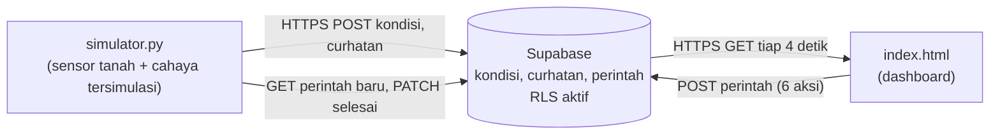

# tanaman-yang-curhat
Aplikasi IoT simulasi pemantauan kondisi tanaman berbasis Python dan Supabase.

# Tanaman yang Curhat (Mawar Rossa)

Aplikasi IoT yang membuat tanaman "bicara". Perangkat (simulator Python) mengirim kelembapan tanah dan cahaya ke Supabase, dashboard web menampilkan suasana hati dan linimasa curhatan, dan enam tombol kendali (siram, keringkan, beri teduh, beri cahaya, beri pupuk, sapa) mengirim perintah balik ke perangkat.

Praktik Integrasi Komputasi Awan dan IoT, D4 Teknik Elektronika UNY, UTS Semester Ganjil 2026.
Pembuat: ROSSA ASTIA KIRANIA PUTRI NIM 24090620041

Video penjelasan: *(tempel tautan YouTube tidak terdaftar atau Google Drive di sini)*

## Arsitektur (Arsitektur A: langsung ke Supabase, HTTPS/REST)



Protokol: HTTP/HTTPS ke REST API Supabase (PostgREST) dengan header `apikey` berisi publishable key.

## Komponen

| Berkas | Fungsi |
|---|---|
| `setup_tabel.sql` | Membuat 3 tabel, mengaktifkan RLS, menulis policy |
| `simulator.py` | Perangkat tersimulasi: kirim data, buat curhatan, baca perintah, kejadian acak (hujan, mendung, terik) |
| `index.html` | Dashboard diorama 3D (mawar pink, awan database, monitor, lampu, sensor, ESP32; memakai three.js dari CDN sehingga perlu internet), gauge, grafik, linimasa dengan filter, 6 tombol kendali |
| `backup.py` | Ekspor semua tabel ke CSV |
| `cek_supabase.py` | Tes cepat URL, key, tabel, dan RLS |

Skema: `kondisi(id, tanah, cahaya, status, dibuat_pada)`, `curhatan(id, status, isi, dibuat_pada)`, `perintah(id, aksi, status, dibuat_pada)`. Semua punya `dibuat_pada` otomatis, disimpan dalam UTC oleh server (WIB = UTC+7). Dashboard menampilkan sesuai zona waktu browser, dan view `kondisi_wib` menampilkan waktu WIB di Supabase.

## Cara menjalankan

### 1. Siapkan Supabase
1. Buka https://supabase.com, daftar, lalu **New project** (beri nama, buat database password dan simpan, pilih region terdekat misalnya Singapore).
2. Tunggu project selesai dibuat (sekitar 1 sampai 2 menit).
3. Buka **SQL Editor** > **New query**, tempel seluruh isi `setup_tabel.sql`, klik **Run**. Skrip ini menghapus tabel lama lalu membuatnya ulang, jadi aman dijalankan di project baru maupun untuk mengulang dari nol. Hasil akhirnya menampilkan 3 tabel dengan `rls_aktif = true`.
4. Cek di **Table Editor**: tiga tabel muncul dengan label RLS aktif. Cek policy di **Authentication > Policies**.
5. Buka **Project Settings > API Keys**: salin **[Project URL](https://yvywoxxlpnxqeraakiri.supabase.co)** dan **sb_publishable_f1oQRtl5vFdimmvxN2hktg_WmTnl7ne** (`sb_publishable_...`).

### 2. Jalankan simulator
```bash
pip install -r requirements.txt

python cek_supabase.py     
python simulator.py         
```

### 3. Buka dashboard
Klik dua kali `index.html` (atau `python -m http.server 8000` lalu buka http://localhost:8000). Saat pertama dibuka, isi Project URL dan publishable key di formulir. Kunci disimpan di browser, bukan di kode.

### 4. Backup
```bash
python backup.py            # menghasilkan backup_<tabel>_<waktu>.csv
```
Alternatif lewat dashboard Supabase: Table Editor > tabel > **Export to CSV**.

## Aturan curhat (dicek dari atas ke bawah)

| Jika | Status |
|---|---|
| Tanah < 25% | Haus |
| Tanah > 85% | Kebanjiran |
| Cahaya < 25% | Kegelapan |
| Cahaya > 90% | Kepanasan |
| Tanah 25 sampai 39% | Agak kering |
| Selain itu | Senang |

## RLS dan keamanan
- RLS aktif di semua tabel; role `anon` (publishable key) hanya punya policy yang diperlukan.
- `kondisi` dan `curhatan`: baca dan tambah saja, tidak bisa ubah atau hapus.
- `perintah`: baca, tambah (hanya aksi siram, keringkan, teduh, terang, pupuk, sapa dengan `status='baru'`), dan ubah hanya dari `baru` ke `selesai`.
- Ada `CHECK` constraint (rentang 0 sampai 100, daftar status) agar data tidak sembarang.
- Hanya publishable key yang dipakai. Pada berkas yang dikumpulkan, nilai `URL` dan `KEY` sudah disamarkan (`xxxxxxxx`).

## Skenario pengujian

| No | Skenario | Cara uji | Hasil yang diharapkan | Hasil sebenarnya |
|---|---|---|---|---|
| 1 | Data mengalir | Jalankan simulator, buka dashboard | Baris baru di `kondisi` tiap 6 detik, angka dashboard berubah | |
| 2 | Curhat sesuai aturan | Tunggu tanah < 25% (atau `--cepat`) | Status "Haus", gelembung berisi kalimat haus | |
| 3 | Tombol kendali | Klik Siram, Keringkan, Beri teduh, Beri cahaya, Beri pupuk, Sapa | Baris `perintah` baru lalu `selesai`, kondisi berubah, Rossa membalas | |
| 4 | Filter linimasa | Pilih suasana "Haus" | Hanya curhatan Haus tampil | |
| 5 | Data kosong | Dashboard dengan tabel kosong | Pesan "Belum ada curhatan...", tidak error | |
| 6 | Koneksi gagal | Matikan internet / URL salah | Banner merah, data lama tetap tampil, pulih otomatis | |
| 7 | RLS menolak hapus | `DELETE` ke `kondisi` dengan publishable key (lewat `cek_supabase.py`) | Tidak ada baris terhapus | HTTP 200, tetapi baris masih ada (tidak ada policy DELETE) |
| 8 | Insert tidak valid | POST `tanah: 150` | Ditolak (HTTP 400, melanggar CHECK) | Ditolak HTTP 400 |


### Kendala dan Solusi

Terdapat dua kendala utama selama pengembangan sistem. Pertama, tombol perintah baru mengalami respons **401 Unauthorized** akibat pembatasan pada constraint dan policy di Supabase. Pada konfigurasi awal, perintah yang diizinkan hanya `siram`. Oleh karena itu, constraint dan policy diperbarui agar mendukung perintah yang diperlukan, kemudian perubahan tersebut diintegrasikan ke dalam file `setup_tabel.sql`.

Kedua, dashboard mengalami kesalahan pemrosesan JSON karena Supabase memberikan respons sukses tanpa isi. Permasalahan ini diatasi dengan menambahkan pemeriksaan terhadap isi respons sebelum data diproses oleh program.

### Penyesuaian Zona Waktu

Kolom `dibuat_pada` menyimpan waktu berdasarkan zona waktu UTC (*Coordinated Universal Time*). Akibatnya, waktu yang ditampilkan pada Table Editor Supabase terlihat tujuh jam lebih awal dibandingkan Waktu Indonesia Barat (WIB). Dashboard telah disesuaikan agar menampilkan waktu berdasarkan zona waktu browser. Selain itu, dibuat *view* bernama `kondisi_wib` untuk menampilkan waktu dalam zona WIB secara langsung melalui Supabase.

### Pencadangan Data

Proses pencadangan data dilakukan menggunakan program `backup.py`. Program tersebut dijalankan untuk mengekspor data dari ketiga tabel ke dalam format CSV. Hasil pencadangan kemudian diperiksa dengan membuka salah satu file CSV untuk memastikan data berhasil diekspor. Seluruh file hasil pencadangan disimpan dalam folder `bukti` sebagai dokumentasi dan arsip data.
## Pengembangan lanjutan
Mengganti `simulator.py` dengan ESP32 (sensor tanah + LDR) hanya perlu mengirim HTTP POST dengan format JSON yang sama ke `/rest/v1/kondisi`.
